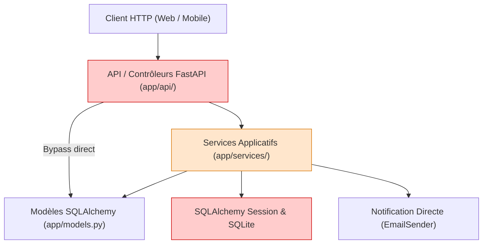
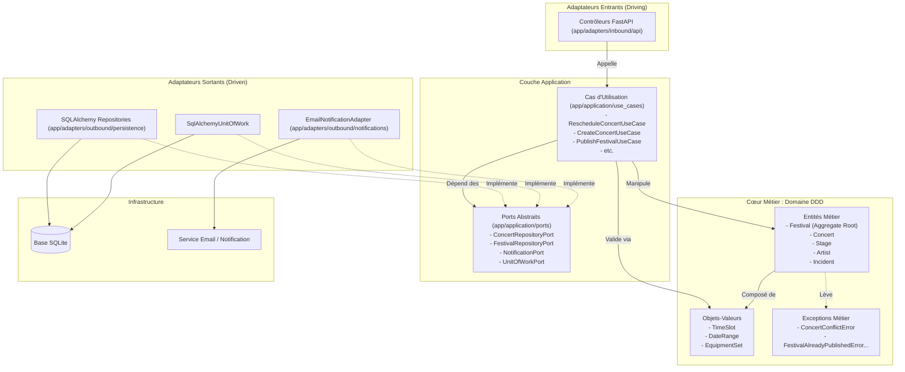
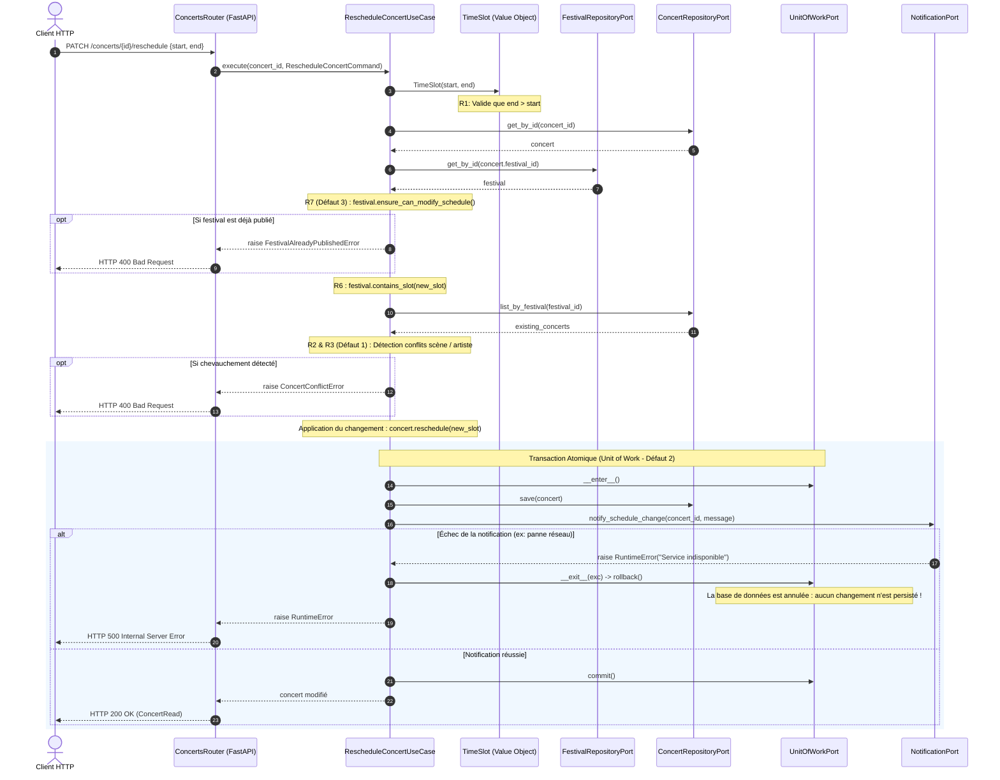

# Note d'Architecture — FestiPlan (Refactorisation Hexagonale & DDD)

Ce document présente la démarche complète d'analyse, de modélisation et de refactorisation de l'API **FestiPlan**, conformément aux exigences du sujet de synthèse.

---

## 1. Diagnostic de l'Architecture Initiale (Legacy)

### 1.1 Problèmes identifiés dans le code initial
L'analyse initiale réalisée sur le projet monolithique de départ a mis en lumière plusieurs défauts majeurs de conception :

1. **Bypass de couches (Contrôleurs HTTP couplés à la persistance)** :
   - Les routeurs FastAPI (`app/api/concerts.py`, `app/api/festivals.py`, `app/api/incidents.py`) importaient directement `SessionLocal`, `get_db` et les modèles SQLAlchemy (`app.models.Concert`).
   - Le contrôleur d'incidents exécutait directement des requêtes SQL (`db.query(Incident)`) sans passer par aucun service ni abstraction.
2. **Couplage technique fort dans les services métier** :
   - Les services (`SchedulingService`, `FestivalService`, `PublicationService`) dépendaient directement de la session SQLAlchemy (`from sqlalchemy.orm import Session`). Il était impossible de tester une règle métier sans démarrer une base de données SQL.
   - Les services lançaient directement des exceptions FastAPI (`HTTPException`) au lieu d'exceptions métier pures, mélangeant protocole HTTP et logique métier.
3. **Effets secondaires mal maîtrisés** :
   - Dans `SchedulingService.reschedule_concert`, un `db.commit()` était exécuté **avant** l'appel au service de notification. En cas de panne de notification, l'API levait une erreur `HTTP 500`, mais les données étaient déjà écrites et persistées en base.
4. **Absence de protection des invariants métier** :
   - Lors du déplacement d'un concert, les conflits d'horaires (même scène ou même artiste) n'étaient pas vérifiés.
   - La modification d'un concert était autorisée même si le festival était officiellement publié (`published`).

### 1.2 Schéma de l'Architecture Initiale (Couplage fort)



---

## 2. Organisation en Architecture Hexagonale (Ports & Adaptateurs)

L'architecture a été restructurée selon le principe d'inversion des dépendances : **le cœur de domaine ne dépend d'aucun framework**.

```
app/
├── domain/                      # 100% Python pur (zéro import FastAPI, SQLAlchemy, HTTP)
│   ├── entities/                # Concert, Festival, Artist, Stage, Incident
│   ├── value_objects/           # TimeSlot, DateRange, EquipmentSet
│   ├── exceptions.py            # Exceptions métier pures (InvalidTimeSlotError, ConcertConflictError...)
│   └── events.py                # Événements de domaine (ConcertRescheduled, FestivalPublished...)
│
├── application/                 # Cas d'utilisation et Contrats (Ports)
│   ├── ports/                   # Interfaces abstraites (repositories, notification_port, unit_of_work)
│   ├── use_cases/               # RescheduleConcert, CreateConcert, PublishFestival, etc.
│   └── dtos.py                  # Commandes et objets de transfert de données
│
├── adapters/                    # Connecteurs vers les technologies extérieures
│   ├── inbound/api/             # Contrôleurs HTTP FastAPI (Primary / Driving Adapters)
│   └── outbound/                # Adaptateurs secondaires (Driven Adapters)
│       ├── persistence/         # Repositories SQLAlchemy & SqlAlchemyUnitOfWork
│       └── notifications/       # EmailNotificationAdapter
│
└── dependencies.py              # Composition Root (Injection de dépendances)
```

### 2.1 Les Couches et leurs responsabilités

| Couche | Rôle & Responsabilité | Dépendances autorisées |
| :--- | :--- | :--- |
| **Domaine (`app/domain`)** | Porte les règles métier, invariants et objets métier. Aucun framework. | **Aucune** (Standard library Python uniquement : `dataclasses`, `datetime`). |
| **Application (`app/application`)** | Orchestre les cas d'utilisation, coordonne les entités et appelle les ports. | Dépend uniquement du **Domaine**. |
| **Ports (`app/application/ports`)** | Définit les contrats (Protocoles Python) requis par l'application (Repositories, Notifications, UoW). | Dépend du **Domaine**. |
| **Adaptateurs Entrants (`adapters/inbound`)** | Reçoit les requêtes HTTP (FastAPI), valide le format Pydantic, appelle le cas d'usage et traduit les retours/exceptions en réponses HTTP. | Dépend de **Application** et de **FastAPI**. |
| **Adaptateurs Sortants (`adapters/outbound`)** | Implémente concrètement les ports (SQLAlchemy pour la base de données, envoi de mails). | Dépend des **Ports**, du **Domaine**, de **SQLAlchemy**. |
| **Composition (`dependencies.py`)** | Assemble et injecte les dépendances concrètes dans les cas d'usage pour FastAPI. | Assemble toutes les couches. |

---

## 3. Modélisation Métier DDD (Domain-Driven Design)

### 3.1 Entités
* **`Festival`** : Identifié par son `id`. Gère son cycle de vie (`preparation` -> `published`). Garantit qu'un planning publié ne peut pas être modifié arbitrairement (**R7**) et qu'un planning ne peut être publié qu'en l'absence de conflits (**R8**).
* **`Concert`** : Identifié par son `id`. Encapsule son créneau horaire (`TimeSlot`), son artiste, sa scène et son statut (`scheduled` / `cancelled`). Propose la méthode `conflicts_with(other)` (**R2** et **R3**).
* **`Stage`** : Identifié par son `id`. Garantit une capacité strictement positive (**R9**) et vérifie si ses équipements couvrent les besoins d'un artiste (**R5**).
* **`Artist`** : Identifié par son `id`. Porte ses équipements techniques requis.
* **`Incident`** : Identifié par son `id`. Obligatoirement associé à un concert existant avec une description non vide (**R10**).

### 3.2 Objets-Valeurs (Value Objects)
* **`TimeSlot`** : Immuable (`@dataclass(frozen=True)`). Valide à l'instanciation que `end_time > start_time` (**R1**). Fournit la méthode `overlaps(other)` pour tester le chevauchement strict.
* **`DateRange`** : Immuable. Valide la période globale du festival et fournit `contains(slot)` pour s'assurer qu'un concert se déroule pendant le festival (**R6**).
* **`EquipmentSet`** : Immuable (`frozenset`). Fournit `is_satisfied_by(available)` pour valider la compatibilité technique scène/artiste (**R5**).

### 3.3 Événements de Domaine
* `ConcertRescheduled` : émis lorsqu'un concert est déplacé avec succès.
* `FestivalPublished` : émis lorsque le festival passe au statut officiel.

---

## 4. Diagrammes UML

### 4.1 Diagramme de Composants (Architecture Réelle)



### 4.2 Diagramme de Séquence : Cas d'Usage « Déplacement d'un concert »

Le diagramme suivant illustre le flux complet lors du cas d'usage `RescheduleConcertUseCase`, montrant la vérification des règles métier, la gestion atomique et le traitement d'un échec de notification :



---

## 5. Résolution des Trois Défauts Initiaux

### Défaut 1 — Chevauchement de concerts
* **Cause initiale** : `SchedulingService.reschedule_concert` modifiait directement les dates du concert sans appeler `_check_conflicts`.
* **Solution apportée** :
  - Création du Value Object `TimeSlot` vérifiant `overlaps(other)`.
  - Dans `RescheduleConcertUseCase`, parcours des concerts existants du festival. Si un concert non annulé se chevauche sur la même scène (**R2**) ou pour le même artiste (**R3**), une exception `ConcertConflictError` est levée.
  - L'adaptateur API intercepte cette exception et renvoie un statut `HTTP 400`.

### Défaut 2 — Échec de notification après modification
* **Cause initiale** : Le code exécutait `db.commit()` avant d'appeler `NotificationService.notify_schedule_change()`. Lorsque la notification échouait, l'API renvoyait 500 alors que les données avaient déjà été enregistrées.
* **Solution apportée** :
  - Mise en place du patron **Unit of Work** (`SqlAlchemyUnitOfWork`).
  - L'enregistrement en base et l'envoi de la notification sont encapsulés dans le bloc transactionnel de l'UoW.
  - Si l'envoi de notification échoue, la transaction est annulée (`rollback()`) : la base de données reste dans son état d'origine. Le test de non-régression valide que la date en base n'a pas été altérée.

### Défaut 3 — Modification d'un planning publié
* **Cause initiale** : Aucune vérification du statut du festival n'était opérée lors du déplacement d'un concert.
* **Solution apportée** :
  - L'entité `Festival` porte la méthode métier `ensure_can_modify_schedule()`.
  - Si `festival.status == "published"`, une exception `FestivalAlreadyPublishedError` (**R7**) est levée.
  - Le cas d'usage bloque l'opération et l'API renvoie `HTTP 400`.

---

## 6. Stratégie de Tests (Pyramide de Tests)

Une suite de tests automatisés à plusieurs niveaux a été implémentée (29 tests au total) :

1. **Tests unitaires du Domaine (`tests/domain/`)** :
   - Tests de `TimeSlot` : validité, créneaux inversés, durées nulles, calculs de chevauchements.
   - Tests de `DateRange` : inclusion temporelle dans le festival (**R6**).
   - Tests de `EquipmentSet` et `Stage` : capacité positive (**R9**), compatibilité d'équipements (**R5**).
   - Tests de `Festival` et `Incident` : règles d'invariants (**R7**, **R8**, **R10**).
   - **Performance** : Exécutés en mémoire pure en quelques millisecondes, sans démarrer FastAPI ni SQLite.
2. **Tests des Cas d'Utilisation (`tests/application/`)** :
   - Utilisation de doubles de test (`tests/application/fakes.py`) : `InMemoryConcertRepository`, `InMemoryFestivalRepository`, `SpyNotificationSender`, `FakeUnitOfWork`.
   - Vérification de l'orchestration, des permissions, des conflits et du comportement atomique lors d'une panne de notification.
3. **Tests d'Intégration & Adaptateurs HTTP (`tests/test_*_api.py`)** :
   - Vérification des réponses HTTP, des codes de statut (201, 200, 400, 404, 422) et de la persistance SQLite via `TestClient`.
4. **Tests de Non-Régression (`tests/test_non_regression_defauts.py`)** :
   - Vérification explicite que les 3 défauts initiaux sont résolus et ne peuvent plus réapparaître.

---

## 7. Limites restantes et compromis techniques

* **Notifications synchrones vs asynchrones** :
  Dans cette implémentation, la notification est synchrone dans l'unité de travail pour garantir l'atomicité attendue par le test de non-régression initial. Dans une architecture à très haute charge, on pourrait privilégier un patron *Transactional Outbox* avec un broker de messages (RabbitMQ / Kafka) pour ne pas bloquer la transaction métier en cas d'indisponibilité du serveur SMTP.
* **Isolation multi-festivals** :
  Le domaine supporte plusieurs festivals. La recherche des conflits est limitée au périmètre d'un festival donné, ce qui optimise les lectures.
